  

  <h3>Desarrollo de software · sistemas, herramientas y experimentos de audio</h3>
  

    Soy Marlon Torres Espinoza (<b>MTE</b>), desarrollador en Perú. 
    Construyo <b>M-Core</b>, una plataforma multi-tenant con enfoque Zero Trust, y herramientas propias en Rust, TypeScript, Go y C++.
  

  
  
  

---

  <h3>Proyectos destacados</h3>
  
  
  
  
  
  

  
    En línea:
    <a href="https://mrln-trrs.github.io/Wallpaper-Whirr-music/">reproductor Whirr</a> ·
    <a href="https://mrln-trrs.github.io/lrpd-productos-compuestos/">portafolio LRPD</a> ·
    <a href="https://mte-portafolio.vercel.app">portafolio y blog</a>
  

---

  <h3>Actividad</h3>
  
  

  

  <picture>
    <source media="(prefers-color-scheme: dark)" srcset="assets/serpiente/oscuro.svg" />
    
  </picture>

  
    Las estadísticas incluyen repositorios privados y se actualizan cada día.
  

---

  <h3>Contacto</h3>
  
  
  
  

